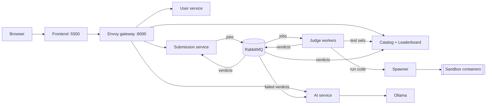

# Mini Code Judge

A small LeetCode-style judge built as a distributed system. Users submit Python code, it runs in a locked-down
sandbox against hidden test cases, and the verdict streams back live. A local LLM gives hints on failed
submissions. The verdict itself always comes from the sandboxed test run, never from the AI.

COMP41720 Distributed Systems group project, University College Dublin.

## Quick start

Requirements: Docker with Compose v2, at least 8 GB of memory for Docker and about 10 GB of disk.

```bash
docker compose up -d --build
```

The first start downloads the AI model (about 4.7 GB). Later starts take under a minute.
Check that everything is healthy with `docker compose ps`.

Open http://localhost:5500 and sign in as `admin@example.com` / `admin-local-only` (local development only).
Five sample problems are loaded.

Stop with `docker compose down`. Add `-v` to also delete all data.

## Architecture



| Service | Language | Responsibility |
| --- | --- | --- |
| Gateway | Envoy | Single entry point: verifies access tokens, rate limits, routes requests |
| User service | Go | Accounts, roles, sessions, Google and GitHub sign-in |
| Submission service | Go | Accepts submissions (202 + transactional outbox), status, live updates over SSE |
| Judge workers | Python | Stateless: take one job at a time, run each test case, publish the verdict |
| Spawner | Python | Only holder of the Docker socket. Keeps a warm pool of locked-down sandbox containers |
| Catalog + Leaderboard | Java, Spring Boot | Problems, versioned immutable test sets, leaderboard built from verdicts |
| AI service | Python | Hints for failed submissions from a local Ollama model, behind a circuit breaker |

Each service has its own PostgreSQL database and login. Services communicate over REST and RabbitMQ:
a work queue for jobs, and a topic exchange that fans verdicts out to each consumer's durable queue.
Delivery is at least once and every consumer is idempotent. Message formats are in
[docs/contracts.md](docs/contracts.md).

## Endpoints

| What | URL | Login |
| --- | --- | --- |
| Web app | http://localhost:5500 | `admin@example.com` / `admin-local-only` |
| API (through the gateway) | http://localhost:8000 | Bearer token from `POST /auth/login` |
| Grafana | http://localhost:3000 | Anonymous view, or admin / `admin-local-only` |
| Prometheus | http://localhost:9090 | None |
| RabbitMQ management | http://localhost:15672 | `judge` / `judge` |
| Catalog API docs | http://localhost:8080/swagger-ui.html | None |

Service ports (8080 to 8085) are published for local debugging only. Clients go through the gateway.

## Try it from the command line

```bash
TOKEN=$(curl -s -X POST localhost:8000/auth/login -H 'Content-Type: application/json' \
  -d '{"email":"admin@example.com","password":"admin-local-only"}' | python3 -c 'import json,sys; print(json.load(sys.stdin)["access_token"])')

curl -s -X POST localhost:8000/api/v1/submissions -H "Authorization: Bearer $TOKEN" -H 'Content-Type: application/json' \
  -d '{"problem_id":"a68b526a-ed8b-55f7-8113-80baab531c65","language":"python","code":"class Solution:\n    def twoSum(self, nums, target):\n        seen = {}\n        for i, x in enumerate(nums):\n            if target - x in seen:\n                return [seen[target - x], i]\n            seen[x] = i\n"}'

curl -s localhost:8000/api/v1/submissions/<submission_id> -H "Authorization: Bearer $TOKEN"
```

The submission is `COMPLETED` with verdict `ACCEPTED` after a few seconds.

## Configuration

Defaults work out of the box. To change them, copy `.env.example` to `.env`. It covers:

- host ports, if one is already in use on your machine
- Google and GitHub sign-in credentials (optional)
- using the native Ollama app on a Mac, which is much faster than Ollama in Docker because Docker cannot use the GPU.

Scale the judge workers with `docker compose up -d --scale judge-worker=5`.

## Tests

| Service | Command |
| --- | --- |
| Catalog | `cd services/catalog && ./mvnw verify` (needs Docker for Testcontainers) |
| Submission, User | `cd services/<service> && go test ./...` |
| Judge worker, Spawner, AI | `cd services/<service> && python -m pytest` |

## Repository layout

```
services/   one folder per service, each with its own Dockerfile and README
frontend/   React + TypeScript web app
deploy/     gateway, RabbitMQ, PostgreSQL, Prometheus and Grafana configuration
docs/       message contracts, AI API, runbook
```

## Operating it

How to observe the system, break it and watch it recover: [docs/runbook.md](docs/runbook.md).
